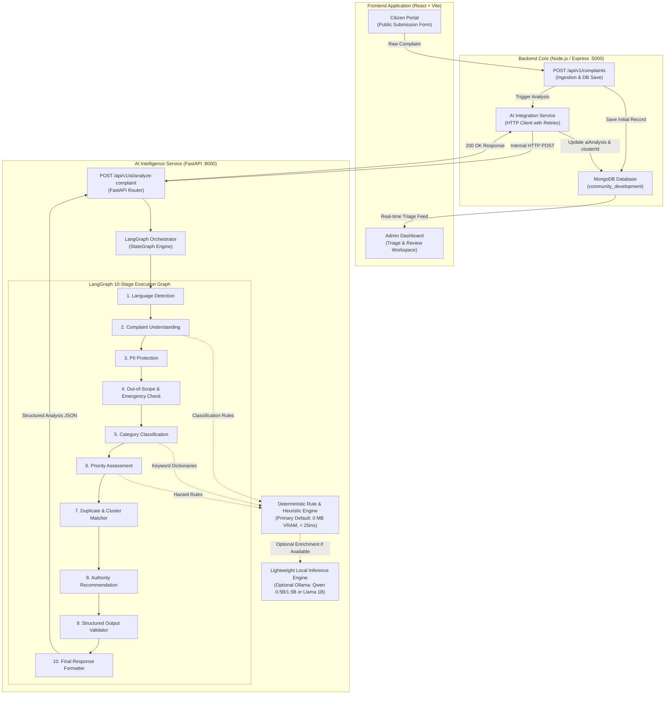
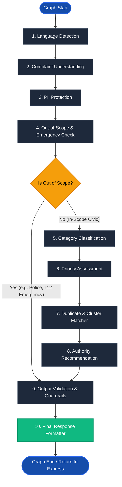
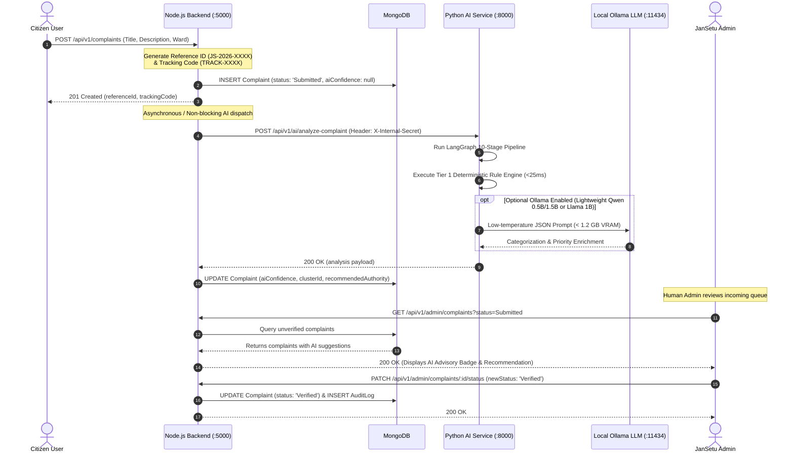
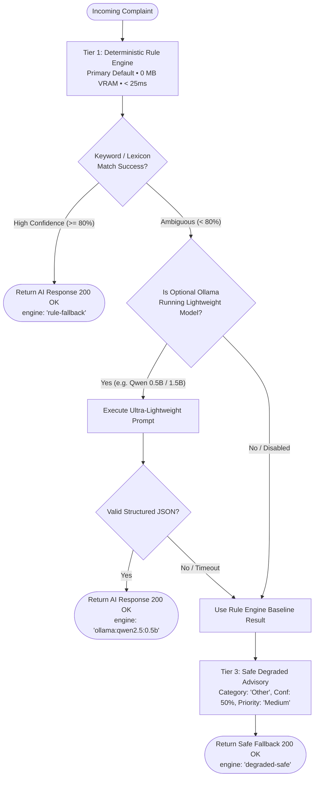
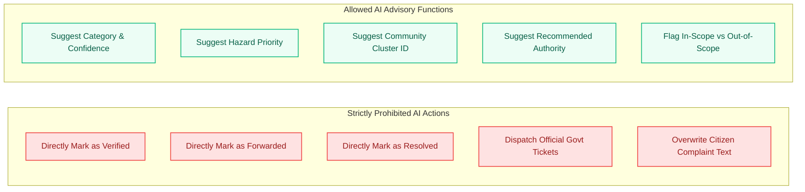

# JanSetu AI — AI Service & LangGraph Workflow Architecture

**Document Version:** 1.0.0  
**Status:** Architecture & Planning Specification  
**Product:** JanSetu AI — Connecting Citizens. Improving Communities.  
**Microservice:** Python (3.11+) / FastAPI (v0.165+) + LangGraph (v1.2.24+) + LangChain-Core (v1.8.4+)  
**Inference Engine:** Local Ollama (v0.6.3+) / Fallback Heuristic Rule Engine  
**Upstream Orchestrator:** Node.js (v20+) / Express (v5.3+) Backend  

---

## 1. Executive Summary & System Philosophy

### 1.1 Purpose
The **JanSetu AI Intelligence Microservice** is a dedicated Python FastAPI service that ingests unstructured citizen complaints, performs multimodal language understanding, extracts structured civic metadata, detects localized duplicate issues, assesses community hazard priority, and suggests appropriate administrative authorities.

### 1.2 Core Architectural Principles & Scope Boundaries

> [!IMPORTANT]
> **Independent Civic-Tech Platform:**  
> JanSetu AI is an independent community intelligence tool built for citizens and community organizers. It is **not** an official government grievance redressal portal, nor does it possess authority, government partnership, or live integration to automatically dispatch municipal crews or register official FIRs/government tickets.

1. **Human-in-the-Loop Governance:**  
   AI output is strictly advisory. The AI service **never** marks a complaint as officially verified, forwarded, or resolved, and never independently mutates the official complaint status. All status transitions and escalation decisions remain exclusively under human administrator supervision via the JanSetu Admin Dashboard.
2. **Single Admin Role (MVP):**  
   The platform implements strictly **one Admin role** (`ADMIN`). The architecture remains extensible for future roles, but only a single admin role is active for the MVP.
3. **Preservation of Raw Citizen Voice:**  
   The citizen's original text, submitted category, and declared language are stored immutably. AI summaries and detected language tags serve only as analytical overlays to assist human triage.
4. **Strict Domain Scoping (MVP):**  
   The platform handles 5 canonical civic domains:
   - `Water Supply` (pipeline ruptures, contaminated water, low pressure, valve leaks)
   - `Roads and Infrastructure` (potholes, cave-ins, broken dividers, missing manhole covers)
   - `Waste Management` (uncollected garbage, overflowing dumpsters, illegal dumping)
   - `Drainage and Sanitation` (clogged drains, sewage backflow, open storm drains)
   - `Streetlights` (non-functional lights, broken poles, dangling wires, dark corridors)
   - `Other` (general neighborhood maintenance, public park debris)
5. **Out-of-Scope Exclusion & Emergency Safety Gate:**  
   Complaints involving emergencies, police matters, domestic violence, criminal acts, medical distress, primary healthcare, public school curriculum/teachers, electrical high-tension lines, land/property revenue disputes, and government welfare/pension schemes are immediately flagged as `isOutOfScope: true`. For emergency cases, immediate public guidance is attached: *"For immediate police, fire, or medical emergencies, please dial 112 directly. JanSetu AI does not dispatch emergency services."*
6. **Finalized Multilingual Scope (Exactly 8 Languages):**  
   The pipeline standardizes on eight official linguistic identifiers:
   - `English` (`en`) — *Fully implemented and tested with regex/keyword rules*
   - `Hindi` (`hi`) — *Fully implemented and tested with Devanagari/Hinglish rules*
   - `Kannada` (`kn`) — *Planned; Heuristic & safe fallback*
   - `Tamil` (`ta`) — *Fully implemented and tested with Tamil script/lexicon rules*
   - `Telugu` (`te`) — *Planned; Heuristic & safe fallback*
   - `Marathi` (`mr`) — *Fully implemented and tested with Marathi lexicon rules*
   - `Assamese` (`as`) — *Planned; Heuristic & safe fallback*
   - `Manipuri (Meitei)` (`mni`) — *Planned; Heuristic & safe fallback*
   - *Language Invariants:* Original raw text is preserved permanently. No speech-to-text, voice recognition, or voice translation is claimed or implied. When language detection confidence is low (< 60%), the system applies safe fallback to manual triage without altering text.
7. **Hardware Constraints & Zero-Dependency Execution Strategy:**  
   The target environment is a portable developer laptop equipped with approximately **8 GB System RAM and an NVIDIA GeForce MX250 GPU with 2 GB VRAM**.
   - Ollama is **strictly optional**. Large local LLMs (e.g., 7B or 8B parameter models) are strictly prohibited as they exceed available VRAM and cause out-of-memory crashes.
   - If Ollama is used, only ultra-lightweight quantized models (such as `qwen2.5:0.5b`, `qwen2.5:1.5b-q4_K_M`, or `llama3.2:1b-instruct-q4_K_M` running CPU-offloaded) may be used.
   - The primary default engine is a high-speed, deterministic rule-based heuristic classifier requiring **0 MB VRAM** and executing in `< 25ms`.
   - Paid external AI APIs (OpenAI, Gemini, Anthropic) are completely optional and not required for the hackathon MVP.

---

## 2. High-Level System Architecture & Communication Topology



---

## 3. LangGraph State Machine Architecture

The core analysis pipeline is built as a compiled `langgraph.graph.StateGraph` utilizing a strongly typed state container (`ComplaintAnalysisState`) executed across 10 distinct logical stages.

### 3.1 State Definition (`ComplaintAnalysisState`)

```python
from typing import TypedDict, List, Optional, Dict, Any

class RecommendedAuthorityState(TypedDict):
    id: str
    name: str
    department: str
    jurisdiction: str

class ComplaintAnalysisState(TypedDict):
    # --- Input Inputs (Immutable) ---
    complaintId: str
    rawTitle: str
    rawDescription: str
    submittedCategory: str
    ward: str
    district: str
    declaredLanguage: Optional[str]
    
    # --- Stage 1: Language Detection & Normalization ---
    detectedLanguage: str       # "English", "Hindi", "Kannada", "Tamil", "Telugu", "Marathi", "Assamese", "Manipuri (Meitei)"
    detectedLanguageCode: str   # "en", "hi", "kn", "ta", "te", "mr", "as", "mni"
    languageConfidence: int     # 0 to 100
    normalizedTitle: str
    normalizedDescription: str
    
    # --- Stage 2: Complaint Understanding ---
    extractedKeyIssue: str
    extractedLandmarks: List[str]
    problemDuration: Optional[str]
    
    # --- Stage 3: PII Protection ---
    redactedTitle: str
    redactedDescription: str
    piiItemsMasked: int
    
    # --- Stage 4: Out-of-Scope & Emergency Detection ---
    isOutOfScope: bool
    outOfScopeCategory: Optional[str]  # "Police", "Emergency", "Healthcare", "Education", "Electricity", "Land Dispute", "Welfare"
    outOfScopeReason: Optional[str]
    emergencyGuidance: Optional[str]    # Directs to 112 if emergency
    
    # --- Stage 5: Category Classification ---
    classifiedCategory: str     # "Water Supply", "Roads and Infrastructure", "Waste Management", "Drainage and Sanitation", "Streetlights", "Other", "Out of Scope"
    categoryConfidence: int     # 0 to 100
    categoryReason: str
    
    # --- Stage 6: Priority & Severity Assessment ---
    priority: str               # "High" | "Medium" | "Low"
    priorityScore: int          # 0 to 100
    priorityReason: str
    
    # --- Stage 7: Duplicate Detection & Clustering ---
    isDuplicate: bool
    suggestedClusterId: Optional[str] # e.g. "CI-105"
    clusterSimilarityScore: Optional[float] # 0.0 to 1.0
    clusterSummary: Optional[str]
    
    # --- Stage 8: Authority Recommendation ---
    recommendedAuthority: Optional[RecommendedAuthorityState]
    authorityConfidence: int    # 0 to 100
    routingReason: str
    
    # --- Stage 9: Output Validation & Guardrails ---
    validationErrors: List[str]
    isValid: bool
    
    # --- Stage 10: Metadata, Formatting & Telemetry ---
    processingTimeMs: int
    engineUsed: str             # "rule-fallback" | "ollama:qwen2.5:0.5b" | "degraded-safe"
    nodeExecutionHistory: List[str]
```

### 3.2 StateGraph Flow & Conditional Branching



    classDef primary fill:#164DAA,stroke:#2563EB,stroke-width:2px,color:#fff;
    classDef branch fill:#F59E0B,stroke:#D97706,stroke-width:2px,color:#000;
    classDef finish fill:#10B981,stroke:#059669,stroke-width:2px,color:#fff;
    classDef node fill:#1E293B,stroke:#334155,stroke-width:1px,color:#F8FAFC;

    class Start,End primary;
    class BranchScope branch;
    class N8 finish;
    class N1,N2,N3,N4,N5,N6,N7 node;
```

---

## 4. Detailed Specification of the 10 Workflow Stages

### Stage 1: Language Detection & Script Analysis (`LanguageDetectionNode`)
- **Primary Function:** Detects the input language of `rawTitle` and `rawDescription` among the 8 supported Indian linguistic codes:
  1. `English` (`en`) — Standard English and Romanized text.
  2. `Hindi` (`hi`) — Devanagari script or Hinglish phonetic forms.
  3. `Kannada` (`kn`) — Kannada script.
  4. `Tamil` (`ta`) — Tamil script.
  5. `Telugu` (`te`) — Telugu script.
  6. `Marathi` (`mr`) — Marathi Devanagari lexicon.
  7. `Assamese` (`as`) — Assamese Eastern Nagari script.
  8. `Manipuri (Meitei)` (`mni`) — Meetei Mayek / Bengali script transliteration.
- **Invariance Rule:** The citizen's raw input strings are **never overwritten**.
- **Implementation Status:** English, Hindi, Marathi, and Tamil are actively implemented with deterministic keyword dictionaries. Kannada, Telugu, Assamese, and Manipuri (Meitei) are planned with safe heuristic fallback.
- **Safe Fallback:** If detection confidence is `< 60%`, defaults to `"English"` (`"en"`) or `"Undetermined"` (`"und"`) without altering text, and marks for manual review.

### Stage 2: Complaint Understanding & Entity Extraction (`ComplaintUnderstandingNode`)
- **Primary Function:** Extracts core semantic civic concepts from the complaint:
  - Civic issue entity (e.g., "broken pipe", "pothole", "dumpster backlog", "open manhole").
  - Physical landmarks, cross-streets, lane numbers, and geographic indicators.
  - Duration/urgency timeline indicators (e.g., "for 3 days", "since yesterday", "recurrent").

### Stage 3: PII Protection & Scrubbing (`PIIScrubbingNode`)
- **Primary Function:** Protects citizen privacy by masking sensitive personally identifiable information prior to analytics logging or clustering:
  - 10-digit Indian mobile numbers (`^[6-9]\d{9}$`) -> `[PHONE_REDACTED]`
  - 12-digit Indian Aadhaar sequences -> `[AADHAAR_REDACTED]`
  - Specific citizen person names -> `[CITIZEN_NAME]`
  - Specific residential door/flat numbers -> `[RESIDENCE]`
- **Preservation:** The raw text remains in the secure database, but all downstream AI prompts and cluster summaries use the redacted text.

### Stage 4: Out-of-Scope Detection & Emergency Guidance (`OutOfScopeDetectionNode`)
- **Primary Function:** Scans for prohibited or excluded problem categories:
  - Police matters, active violent crime, robbery, assault, theft.
  - Medical emergencies, cardiac arrest, ambulance dispatch.
  - Primary healthcare clinic operations, public school teacher/curriculum disputes.
  - High-voltage power transmission grid (state electricity distribution board).
  - Private civil tenancy or land boundary disputes.
  - Government welfare/pension/ration card subsidy disbursements.
- **Emergency Safety Routing:** If an emergency or police issue is detected:
  - Sets `isOutOfScope: true` and `outOfScopeCategory`.
  - Attaches immediate public safety guidance: *"CRITICAL: For immediate police, fire, or medical emergencies, please dial 112 directly. JanSetu AI is an independent community intelligence system and does NOT dispatch emergency services."*
  - Bypasses Stages 5, 6, 7, and 8 directly to Stage 9 (Validation).

### Stage 5: Category Classification (`CategoryClassificationNode`)
- **Primary Function:** Maps in-scope civic complaints into one of the 5 canonical MVP categories or "Other":
  1. `Water Supply`
  2. `Roads and Infrastructure`
  3. `Waste Management`
  4. `Drainage and Sanitation`
  5. `Streetlights`
  6. `Other` (general neighborhood maintenance, civic parks)
- **Confidence Computation:** Scores category confidence (0 to 100). If confidence is `< 65%`, flags `categoryReason: "LOW_CONFIDENCE_FLAGGED_FOR_ADMIN"`.
- **Discrepancy Logging:** If the citizen's self-selected `submittedCategory` differs from the AI classification, both are retained in state for human admin review.

### Stage 6: Priority & Severity Assessment (`PriorityAssessmentNode`)
- **Primary Function:** Evaluates the severity and public hazard level:
  - `High`: Contaminated drinking water, open manholes on arterial roads, active sewage flooding into homes/schools, exposed live wires on broken streetlight poles.
  - `Medium`: Multi-day uncollected garbage, large potholes creating traffic snarls, intermittent low water pressure, consecutive dark streetlights.
  - `Low`: Cosmetic wall cracks, minor park leaf litter, single flickering bulb in well-lit area.
- **Output:** Emits `priority: "High" | "Medium" | "Low"` accompanied by a concise, human-readable `priorityReason`.

### Stage 7: Related & Duplicate Complaint Clustering (`ClusteringNode`)
- **Primary Function:** Groups complaints representing the same underlying neighborhood problem.
- **Geographic Constraint:** Comparisons are strictly constrained to complaints within the **same municipal ward** or local area.
- **Clustering Logic:**
  - Evaluates semantic similarity against active `CommunityIssue` clusters in that ward.
  - If similarity exceeds threshold (`> 0.80`), flags `isDuplicate: true` and associates `suggestedClusterId: "CI-XXX"`.
  - If no match exists, sets `isDuplicate: false` and proposes creating a new cluster candidate if priority is High.

### Stage 8: Authority Recommendation (`AuthorityRecommendationNode`)
- **Primary Function:** Maps the categorized issue to the appropriate local civic authority directory:

| Category | Recommended Authority (Standard MVP Directory) | Authority ID | Jurisdiction |
|---|---|---|---|
| `Water Supply` | Municipal Water Supply & Sewerage Board | `AUTH-01` | Metro Municipal Corporation (All Wards) |
| `Roads and Infrastructure` | Public Works Department (PWD - Roads Wing) | `AUTH-02` | Central & Highway Division |
| `Waste Management` | Solid Waste Management & Sanitation Board | `AUTH-03` | North & East Municipal Zones |
| `Streetlights` | Municipal City Electrical & Street Lighting Cell | `AUTH-04` | Metropolitan Grid Divisions |
| `Drainage and Sanitation` | Drainage & Stormwater Infrastructure Wing | `AUTH-05` | Lowland & River Basin Sectors |
| `Other` | Department of Public Parks & Urban Horticulture | `AUTH-06` | Civic Gardens & Public Grounds |

> [!CAUTION]
> **Advisory Only:** This is strictly an advisory recommendation for the human administrator. No automated municipal tickets, emails, or dispatches are triggered.

### Stage 9: Structured-Output Validation & Guardrails (`StructuredOutputValidationNode`)
- **Primary Function:** Enforces strict Pydantic model validation and system guardrails:
  1. Status Invariant: Asserts that no stage attempted to modify complaint status (the field remains strictly managed by human admins).
  2. Range Checks: Asserts `categoryConfidence`, `languageConfidence`, and `priorityScore` are integers between 0 and 100.
  3. Enum Adherence: Verifies category, priority, and language codes strictly match the standardized enums.
  4. Emergency Verification: Verifies that any out-of-scope emergency includes explicit `emergencyGuidance`.

### Stage 10: Final Result Formatting & Telemetry (`FinalResultNode`)
- **Primary Function:** Formats the final validated payload matching the official `API_CONTRACT.md` response envelope, adds execution latency metrics (`processingTimeMs`), and tags the engine used (`"rule-fallback"`, `"ollama:qwen2.5:0.5b"`, or `"degraded-safe"`).

---

## 5. Input and Output JSON Schemas

### 5.1 FastAPI Request Schema (`POST /api/v1/ai/analyze-complaint`)

```json
{
  "$schema": "http://json-schema.org/draft-07/schema#",
  "title": "AnalyzeComplaintRequest",
  "type": "object",
  "required": ["complaintId", "title", "description", "ward"],
  "properties": {
    "complaintId": {
      "type": "string",
      "pattern": "^JS-\\d{4}-\\d{4,6}$",
      "description": "Public Reference ID of the saved complaint"
    },
    "title": {
      "type": "string",
      "minLength": 5,
      "maxLength": 150,
      "description": "Raw complaint title submitted by citizen"
    },
    "description": {
      "type": "string",
      "minLength": 10,
      "maxLength": 3000,
      "description": "Raw complaint description submitted by citizen"
    },
    "submittedCategory": {
      "type": "string",
      "enum": [
        "Water Supply",
        "Roads and Infrastructure",
        "Waste Management",
        "Drainage and Sanitation",
        "Streetlights",
        "Other"
      ],
      "description": "Category selected by citizen in the frontend UI"
    },
    "ward": {
      "type": "string",
      "description": "Municipal ward identifier (e.g., 'Ward 3', 'Ward 12')"
    },
    "district": {
      "type": "string",
      "default": "Pune",
      "description": "City or municipal district"
    },
    "language": {
      "type": "string",
      "default": "English",
      "description": "Language declared or detected in browser"
    }
  }
}
```

### 5.2 FastAPI Response Schema (`200 OK`)

```json
{
  "$schema": "http://json-schema.org/draft-07/schema#",
  "title": "AnalyzeComplaintResponse",
  "type": "object",
  "required": ["success", "complaintId", "analysis", "meta"],
  "properties": {
    "success": { "type": "boolean" },
    "complaintId": { "type": "string" },
    "analysis": {
      "type": "object",
      "required": [
        "detectedLanguage",
        "sanitizedSummary",
        "classifiedCategory",
        "categoryConfidence",
        "priority",
        "priorityReason",
        "isDuplicate",
        "isOutOfScope"
      ],
      "properties": {
        "detectedLanguage": { "type": "string" },
        "detectedLanguageCode": {
          "type": "string",
          "enum": ["en", "hi", "kn", "ta", "te", "mr", "as", "mni", "und"]
        },
        "languageConfidence": {
          "type": "integer",
          "minimum": 0,
          "maximum": 100
        },
        "sanitizedSummary": { "type": "string" },
        "classifiedCategory": {
          "type": "string",
          "enum": [
            "Water Supply",
            "Roads and Infrastructure",
            "Waste Management",
            "Drainage and Sanitation",
            "Streetlights",
            "Other",
            "Out of Scope"
          ]
        },
        "categoryConfidence": {
          "type": "integer",
          "minimum": 0,
          "maximum": 100
        },
        "priority": {
          "type": "string",
          "enum": ["High", "Medium", "Low"]
        },
        "priorityReason": { "type": "string" },
        "isDuplicate": { "type": "boolean" },
        "suggestedClusterId": {
          "type": ["string", "null"]
        },
        "clusterSimilarityScore": {
          "type": ["number", "null"],
          "minimum": 0.0,
          "maximum": 1.0
        },
        "recommendedAuthority": {
          "type": ["object", "null"],
          "properties": {
            "id": { "type": "string" },
            "name": { "type": "string" },
            "department": { "type": "string" }
          }
        },
        "isOutOfScope": { "type": "boolean" },
        "outOfScopeReason": { "type": ["string", "null"] },
        "emergencyGuidance": { "type": ["string", "null"] }
      }
    },
    "meta": {
      "type": "object",
      "properties": {
        "processingTimeMs": { "type": "integer" },
        "engine": { "type": "string" },
        "version": { "type": "string" },
        "timestamp": { "type": "string", "format": "date-time" }
      }
    }
  }
}
```

---

## 6. Representative Request & Response Payloads

### 6.1 Standard In-Scope Complaint (Sewage Overflow)

#### Request (`POST /api/v1/ai/analyze-complaint`)
```json
{
  "complaintId": "JS-2026-8909",
  "title": "Severe sewage overflow outside Model High School gate",
  "description": "Black contaminated water pooling for 3 days after heavy rains. Footpath is completely submerged, students cannot enter the school gate safely.",
  "submittedCategory": "Drainage and Sanitation",
  "ward": "Ward 3",
  "district": "Pune",
  "language": "English"
}
```

#### Response (`200 OK`)
```json
{
  "success": true,
  "complaintId": "JS-2026-8909",
  "analysis": {
    "detectedLanguage": "English",
    "detectedLanguageCode": "en",
    "languageConfidence": 98,
    "sanitizedSummary": "Sewage and storm drain backflow submerging pedestrian footpath near school entrance.",
    "classifiedCategory": "Drainage and Sanitation",
    "categoryConfidence": 96,
    "priority": "High",
    "priorityReason": "Direct public health hazard and pedestrian access obstruction adjacent to an educational facility.",
    "isDuplicate": true,
    "suggestedClusterId": "CI-105",
    "clusterSimilarityScore": 0.89,
    "recommendedAuthority": {
      "id": "AUTH-05",
      "name": "Drainage & Stormwater Infrastructure Wing",
      "department": "Drainage and Sanitation"
    },
    "isOutOfScope": false,
    "outOfScopeReason": null,
    "emergencyGuidance": null
  },
  "meta": {
    "processingTimeMs": 24,
    "engine": "rule-fallback",
    "version": "1.0.0",
    "timestamp": "2026-11-25T08:15:22.100Z"
  }
}
```

### 6.2 Multilingual Regional Complaint (Hindi/Marathi Pothole Report)

#### Request (`POST /api/v1/ai/analyze-complaint`)
```json
{
  "complaintId": "JS-2026-8910",
  "title": "मुख्य रस्त्यावर मोठा खड्डा पडला आहे",
  "description": "शिवाजी नगर चौकाजवळ डांबरी रस्ता खचला आहे. काल रात्री दोन दुचाकीस्वार घसरून पडले. तातडीने दुरुस्ती करा.",
  "submittedCategory": "Roads and Infrastructure",
  "ward": "Ward 7",
  "district": "Pune",
  "language": "Marathi"
}
```

#### Response (`200 OK`)
```json
{
  "success": true,
  "complaintId": "JS-2026-8910",
  "analysis": {
    "detectedLanguage": "Marathi",
    "detectedLanguageCode": "mr",
    "languageConfidence": 98,
    "sanitizedSummary": "Large asphalt road collapse / pothole near Shivaji Nagar Chowk causing two-wheeler accidents.",
    "classifiedCategory": "Roads and Infrastructure",
    "categoryConfidence": 98,
    "priority": "High",
    "priorityReason": "Road cave-in has already caused vehicular accidents with imminent risk to motorists.",
    "isDuplicate": false,
    "suggestedClusterId": null,
    "clusterSimilarityScore": null,
    "recommendedAuthority": {
      "id": "AUTH-02",
      "name": "Public Works Department (PWD - Roads Wing)",
      "department": "Roads and Infrastructure"
    },
    "isOutOfScope": false,
    "outOfScopeReason": null,
    "emergencyGuidance": null
  },
  "meta": {
    "processingTimeMs": 28,
    "engine": "rule-fallback",
    "version": "1.0.0",
    "timestamp": "2026-11-25T08:16:45.340Z"
  }
}
```

### 6.3 Out-of-Scope Complaint (Emergency / Police Issue)

#### Request (`POST /api/v1/ai/analyze-complaint`)
```json
{
  "complaintId": "JS-2026-8911",
  "title": "Shops being vandalized and fight in alley",
  "description": "Two groups are throwing bottles and damaging storefronts on Market Road right now. Send police emergency squad immediately.",
  "submittedCategory": "Other",
  "ward": "Ward 2",
  "district": "Pune",
  "language": "English"
}
```

#### Response (`200 OK`)
```json
{
  "success": true,
  "complaintId": "JS-2026-8911",
  "analysis": {
    "detectedLanguage": "English",
    "detectedLanguageCode": "en",
    "languageConfidence": 99,
    "sanitizedSummary": "Active violent brawl and commercial property vandalism in progress.",
    "classifiedCategory": "Out of Scope",
    "categoryConfidence": 99,
    "priority": "High",
    "priorityReason": "Active criminal activity and imminent public safety emergency. Excluded from municipal civic platform.",
    "isDuplicate": false,
    "suggestedClusterId": null,
    "clusterSimilarityScore": null,
    "recommendedAuthority": null,
    "isOutOfScope": true,
    "outOfScopeReason": "Active emergency / law enforcement matter excluded from civic municipal platform.",
    "emergencyGuidance": "CRITICAL: For immediate police, fire, or medical emergencies, please dial 112 directly. JanSetu AI does NOT dispatch emergency services."
  },
  "meta": {
    "processingTimeMs": 14,
    "engine": "rule-fallback",
    "version": "1.0.0",
    "timestamp": "2026-11-25T08:18:10.050Z"
  }
}
```

---

## 7. Node.js Backend & Python AI Service Communication Flow

### 7.1 Sequence Diagram: Submission to Advisory Enrichment



### 7.2 Inter-Service Security & Network Invariants
1. **Internal Shared Secret:** All HTTP requests from the Node.js backend must include the header:
   ```http
   X-Internal-Secret: <AI_SERVICE_INTERNAL_SECRET>
   ```
   Requests missing this header or presenting an invalid token receive a `403 Forbidden` response.
2. **Network Isolation:** In production, port `8000` is bound strictly to `127.0.0.1` or deployed on an internal container network, preventing direct public internet exposure.
3. **Timeout Strategy:** Node.js executes calls with an `8000ms` (8 second) timeout. If the AI service does not respond within this window, Node.js marks the complaint with `aiConfidence: 0` and `status: "Submitted"` so administrative workflow is never blocked.

---

## 8. Hardware Constraints, Resilience & Three-Tier Execution Strategy

### 8.1 Hardware Environment Constraints
The target development and demonstration environment is an ultra-portable laptop characterized by:
- **Host RAM:** ~8 GB DDR4 System Memory.
- **Dedicated GPU:** NVIDIA GeForce MX250 with **2 GB VRAM**.
- **Architectural Implication:** Standard 7B/8B or unquantized 3B LLM models exceed available GPU memory and will crash with CUDA Out-Of-Memory (OOM) errors or cause severe OS thrashing.
- **Operational Rule:** **Ollama is strictly optional.** The core system operates with 100% feature completeness and reliability without Ollama or any external network connection. Paid commercial AI API keys (OpenAI, Gemini, Anthropic) are never required.



### 8.2 Tier 1: Deterministic Rule & Lexicon Engine (Primary Default)
- **Resource Footprint:** 0 MB VRAM, < 15 MB RAM, < 25 ms execution latency.
- **Operational Status:** 100% standalone, zero external dependencies.
- **Multilingual Lexicons & Regex Dictionaries:**
  - `Water Supply`:
    - English: `water`, `pipeline`, `leak`, `drinking`, `tanker`, `supply`, `pressure`, `tap`, `contamination`, `muddy`.
    - Hindi: `पानी`, `पाइपलाइन`, `रिसाव`, `गंदा पानी`, `सप्लाई`, `नल`.
    - Marathi: `पाणी`, `पाईपलाईन`, `गळती`, `नळ`, `दूषित पाणी`, `पाणीपुरवठा`.
    - Tamil: `தண்ணீர்`, `குழாய்`, `கசிவு`, `குடிநீர்`, `நீர் விநியோகம்`.
  - `Roads and Infrastructure`:
    - English: `pothole`, `road`, `divider`, `asphalt`, `tar`, `speed breaker`, `footpath`, `pavement`, `cave-in`, `manhole cover`.
    - Hindi: `गड्ढा`, `सड़क`, `डिवाइडर`, `फुटपाथ`, `रास्ता`.
    - Marathi: `खड्डा`, `रस्ता`, `डांबर`, `पदपथ`.
    - Tamil: `குழி`, `சாலை`, `நடைபாதை`.
  - `Waste Management`:
    - English: `garbage`, `trash`, `dump`, `bin`, `waste`, `debris`, `litter`, `smell`, `sweeper`, `dumpster`.
    - Hindi: `कचरा`, `कूड़ा`, `कूड़ेदान`, `सफाई`.
    - Marathi: `कचरा`, `कचराकुंडी`, `घाण`.
    - Tamil: `குப்பை`, `குப்பைத்தொட்டி`.
  - `Drainage and Sanitation`:
    - English: `sewage`, `drain`, `gutter`, `overflow`, `manhole`, `clogged`, `black water`, `stormwater`, `stagnant`.
    - Hindi: `नाली`, `गटर`, `सीवर`, `गंदा पानी`, `उफान`.
    - Marathi: `गटार`, `सांडपाणी`, `नाली`.
    - Tamil: `சாக்கடை`, `கழிவுநீர்`.
  - `Streetlights`:
    - English: `light`, `lamp`, `pole`, `dark`, `bulb`, `wire`, `darkness`, `night`, `streetlight`.
    - Hindi: `स्ट्रीट लाइट`, `बत्ती`, `खंभा`, `अंधेरा`.
    - Marathi: `दिवाबत्ती`, `खांब`, `अंधार`.
    - Tamil: `தெருவிளக்கு`, `மின்சாரக் கம்பம்`, `இருள்`.
- **Heuristic Priority Scoring Rules:**
  - `High`: Triggered if text contains `accident`, `danger`, `hospital`, `school`, `death`, `injury`, `severe`, `flooding`, `overflow`, `sparking wire`, `cave-in`, `contaminated`.
  - `Medium`: Triggered if text contains `broken`, `stinking`, `multiple days`, `traffic delay`, `dark stretch`, `low pressure`.
  - `Low`: Triggered for cosmetic damage, single flickering bulb, park boundary masonry.

### 8.3 Tier 2: Lightweight Local LLM via Ollama (Strictly Optional)
- **Applicability:** Used ONLY if Ollama is running and explicitly enabled in `.env` (`ENABLE_OLLAMA=true`).
- **Allowed Models on NVIDIA MX250 (2 GB VRAM):**
  - `qwen2.5:0.5b` (Q4_K_M: ~380 MB VRAM) — Recommended ultra-compact model.
  - `qwen2.5:1.5b-instruct-q4_K_M` (~980 MB VRAM) — Fast, high quality, fits within 2 GB limit.
  - `llama3.2:1b-instruct-q4_K_M` (~850 MB VRAM) — High precision multilingual instruction model.
- **Execution Safeguard:** Hard timeout capped at 3000ms. If inference exceeds 3000ms, execution falls back immediately to Tier 1 without blocking the user.

### 8.4 Tier 3: Safe Degraded Advisory (Absolute Safety Net)
If unparseable input is provided:
- `classifiedCategory`: `"Other"`
- `categoryConfidence`: `50`
- `priority`: `"Medium"`
- `priorityReason`: `"Automated analysis inconclusive. Flagged for primary human administrator triage."`
- `recommendedAuthority`: `"AUTH-06"` (Department of Public Parks & Urban Horticulture / General Civic Cell)
- `engineUsed`: `"degraded-safe"`
- `priorityReason`: `"Automated analysis inconclusive. Flagged for primary human triage."`
- `recommendedAuthority`: `"AUTH-06"` (General Civic Cell)

---

## 9. Safety Guardrails & Human-in-the-Loop Governance



### 9.1 The Five Architectural Invariants
1. **Zero Status Mutation:** The AI service contract contains **no parameter** to update a complaint's official status (`Submitted`, `Verified`, `Forwarded`, `Acknowledged`, `In Progress`, `Reported Resolved`, `Verified Resolved`). Status mutations can **only** occur via authenticated admin requests (`PATCH /api/v1/admin/complaints/:id/status`).
2. **Citizen Text Invariance:** The database fields `title` and `description` are immutable from the AI side. AI generates `sanitizedSummary` and `keyIssue` as supplementary read-only analytical fields.
3. **No External Government API Calls:** JanSetu AI does not integrate with, emulate, or call government ERPs or municipal grievance portals. All authority data is purely organizational metadata to guide local volunteer/admin follow-ups.
4. **Mandatory Audit Logging:** Whenever a human admin accepts, overrides, or rejects an AI recommendation, the backend creates an immutable `AuditLog` entry documenting the admin's identity, the previous state, the new state, and the admin's rationale note.
5. **PII Cleansing:** All AI log outputs and prompt traces automatically redact citizen phone numbers and Aadhaar numbers to safeguard citizen anonymity.

---

## 10. AI Service Project Directory Structure & Implementation Roadmap

### 10.1 Planned Codebase Structure (`ai-service/app/`)

```text
ai-service/
├── app/
│   ├── main.py                     # FastAPI application entrypoint & middleware
│   │
│   ├── api/
│   │   ├── __init__.py
│   │   └── v1/
│   │       ├── __init__.py
│   │       ├── router.py           # Top-level API router
│   │       ├── analyze.py          # POST /api/v1/ai/analyze-complaint handler
│   │       └── health.py           # GET /api/v1/ai/health check handler
│   │
│   ├── core/
│   │   ├── __init__.py
│   │   ├── config.py               # Pydantic Settings (ENV loading)
│   │   ├── security.py             # Internal API secret validator
│   │   └── constants.py            # Canonical categories, authorities, priorities
│   │
│   ├── schemas/
│   │   ├── __init__.py
│   │   ├── request.py              # Pydantic models for incoming complaint
│   │   └── response.py             # Pydantic models for analysis output
│   │
│   ├── agents/
│   │   ├── __init__.py
│   │   ├── state.py                # ComplaintAnalysisState TypedDict
│   │   ├── workflows/
│   │   │   ├── __init__.py
│   │   │   └── complaint_graph.py  # LangGraph 10-Stage StateGraph compiler
│   │   └── nodes/
│   │       ├── __init__.py
│   │       ├── language_node.py    # Stage 1: 8-language detection & code tagging
│   │       ├── understanding_node.py # Stage 2: Entity & landmark extraction
│   │       ├── pii_node.py         # Stage 3: Phone/Aadhaar/Name redaction
│   │       ├── scope_node.py       # Stage 4: Out-of-scope & emergency detection
│   │       ├── category_node.py    # Stage 5: 5-domain category classification
│   │       ├── priority_node.py    # Stage 6: Public hazard priority scoring
│   │       ├── clustering_node.py  # Stage 7: Ward-scoped duplicate detection
│   │       ├── authority_node.py   # Stage 8: Authority directory mapping
│   │       ├── validator_node.py   # Stage 9: Pydantic guardrail validation
│   │       └── formatter_node.py   # Stage 10: JSON API response formatting
│   │
│   ├── services/
│   │   ├── __init__.py
│   │   ├── rule_fallback.py        # Tier 1: Zero-VRAM deterministic regex/keyword engine
│   │   ├── ollama_service.py       # Tier 2: Optional ultra-lightweight Ollama client
│   │   └── similarity_service.py   # Ward-scoped text overlap / cluster similarity
│   │
│   └── utils/
│       ├── __init__.py
│       ├── pii_scrubber.py         # Regex patterns for Indian phone/Aadhaar/names
│       └── logger.py               # Structured JSON logger
│
├── .env.example                    # HOST, PORT, ENABLE_OLLAMA, OLLAMA_BASE_URL, BACKEND_URL
└── requirements.txt                # FastAPI, LangGraph, LangChain, Ollama, Pydantic
```

### 10.2 Hackathon 6-Hour Implementation Roadmap

| Phase | Duration | Objective | Deliverables |
|---|---|---|---|
| **Phase 1: Foundation & Tier 1 Rule Engine** | 1 Hour | Scaffold FastAPI app, Pydantic schemas, and Tier 1 Rule Classifier | - Working `POST /api/v1/ai/analyze-complaint`<br/>- 100% reliable 0 MB VRAM regex category & priority engine<br/>- `health.py` status endpoint |
| **Phase 2: LangGraph 10-Stage Pipeline** | 1.5 Hours | Construct LangGraph StateGraph with all 10 stages and typed state | - `complaint_graph.py` with compiled 10-stage state graph<br/>- PII scrubber utility & 112 emergency advice branch |
| **Phase 3: Optional Lightweight LLM Hook** | 1 Hour | Connect optional Ollama wrapper for Qwen 0.5B/1.5B (low-memory) | - Low-temperature JSON prompts for subtle descriptions<br/>- Hard timeout & automatic fallback to Tier 1 |
| **Phase 4: Clustering & Authority Directory**| 1.5 Hours | Implement ward-scoped duplicate matching & Authority lookup table | - Ward-constrained similarity matcher<br/>- Authority directory dictionary matching `API_CONTRACT.md` |
| **Phase 5: End-to-End Integration & Polish** | 1 Hour | Connect Node.js Express backend to AI service and verify in UI | - Verify complaint intake creates advisory record in MongoDB<br/>- Confirm Admin Dashboard displays AI badges cleanly<br/>- Run edge-case tests (Hindi, Tamil, Marathi, Emergency 112) |

---

## 11. Verification & Testing Strategy

### 11.1 Automated Python Test Suite
A lightweight pytest harness in `ai-service/tests/` verifies each node in isolation:
1. `test_language_detection`: Asserts English, Hindi, and Marathi text return appropriate language codes without mutating `rawTitle` or `rawDescription`.
2. `test_pii_redaction`: Verifies 10-digit mobile numbers (`9876543210`) and 12-digit Aadhaar sequences are replaced with redaction tokens.
3. `test_out_of_scope_rejection`: Asserts inputs mentioning armed robbery, domestic violence, or hospital emergency return `isOutOfScope: true` and bypass normal classification.
4. `test_rule_fallback_resilience`: Simulates Ollama downtime (by setting an invalid port) and confirms the service returns `200 OK` with `"engine": "rule-fallback"`.
5. `test_guardrail_immutability`: Confirms that the output state contains no `status` mutations and that confidence scores stay strictly within `[0, 100]`.

### 11.2 Verification Checklist for Developers
- [ ] Raw citizen complaint text is strictly preserved in both input and output state.
- [ ] Out-of-scope domains (police, emergency, health, welfare, electricity grid) are cleanly caught.
- [ ] No node attempts to change complaint status or simulate government dispatch.
- [ ] Service starts cleanly with `uvicorn app.main:app --port 8000 --reload`.
- [ ] Service returns valid analysis within 50ms when running Tier 1 deterministic rule engine.

---

## 12. Multilingual Voice Interaction Pipeline (STT & TTS)

JanSetu AI extends the complaint workflow with optional, privacy-first multilingual **Speech-to-Text (STT)** and **Text-to-Speech (TTS)** without altering the citizen complaint LangGraph pipeline (`complaint_graph.py`):

### 12.1 Added Voice & Extraction Modules (`ai-service/app/`)
- `core/voice_config.py` — Environment configuration (`ENABLE_VOICE_STT`, `ENABLE_VOICE_TTS`, `WHISPER_MODEL_SIZE` (`small` active in `.env`/`.env.example`, `base` safe fallback), `WHISPER_DEVICE="cpu"`, `WHISPER_COMPUTE_TYPE="int8"`, `PIPER_AUTO_DOWNLOAD=false`, size/duration caps, optional Bhashini credentials).
- `services/language_registry.py` — Canonical 23-language capability registry (English + all 22 Eighth Schedule languages) exposing script metadata, RTL flags (`ur`, `ks`, `sd`), Whisper codes, preloaded vs on-demand Piper checkpoints, benchmarked quality status tiers, and explicit limitations.
- `services/language_detection_service.py` — Script Unicode range classification (`ta`, `kn`, `te`, `ml`, `gu`, `pa`, `or`, `sat`, `mni`, `bn`/`as`, `ur`/`sd`/`ks`) plus Devanagari lexical disambiguation (`mr`, `ne`, `sa`, `mai`, `kok`, `brx`, `doi`, `hi`) used by both `language_node.py` and post-STT script refinement.
- `services/stt_service.py` — Local `faster-whisper` (`small`/`base`, INT8 CPU) transcription with magic-byte validation (`RIFF/WAVE`, `WebM`, `OGG`, `FLAC`, `MP3`, `M4A`), `64`-byte minimum & `10 MB` maximum checks, `120s` duration enforcement, repetition guards (`no_repeat_ngram_size=3`, `repetition_penalty=1.15`, `beam_size=1` on slow low-resource scripts), logprob confidence scoring, and foreign/script-drift warnings.
- `services/complaint_extraction_service.py` — Deterministic structured complaint extractor (`POST /api/v1/voice/extract-complaint`) parsing `title`, cleaned `description`, `category`, `categoryCode`, `state`, `district`, and `ward` from English and Indian-language transcripts against `app/data/india_locations.json` without inferring ward numbers or silently overwriting manually entered fields.
- `services/tts_service.py` — Bounded (`OrderedDict` max `2` cached models) `piper-tts` ONNX synthesis, identifier verbalization (`JS-YYYY-NNNN` spacing via `preprocess_tts_text`), playback speed scaling (`[0.75, 1.5]`), explicit refusal (`422 TTS_VOICE_UNAVAILABLE`, `browserFallbackAllowed: true`) instead of silently substituting English, and temporary WAV cleanup.
- `services/voice_provider_service.py` — Pluggable router delegating to local Whisper/Piper first and optionally falling back to Digital India **Bhashini** (ULCA / Dhruva REST inference) only when `ENABLE_BHASHINI=true` and valid credentials are configured.

### 12.2 Safety & Non-Auto-Submission Guarantee
- Voice transcription populates an editable `TranscriptPreview.jsx` and `ExtractedFieldsPreview.jsx` inside the citizen modal; complaints still require explicit human confirmation and submit through `POST /api/v1/complaints`.
- Raw audio recordings and synthesized WAV outputs are never persisted in MongoDB or logged.
- Confidential admin data, internal notes, and private tracking tokens are excluded from TTS summaries.
