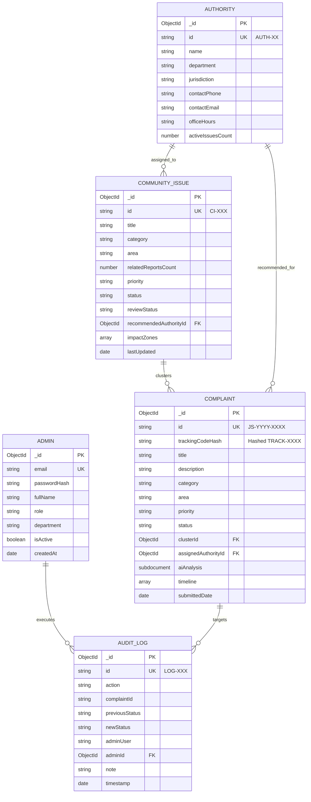

# JanSetu AI — Database Design & Schema Specification

**Document Version:** 1.0.0  
**Status:** Architecture & Planning Specification  
**Target Engine:** MongoDB 7.0+ with Mongoose 8.x / 9.x  
**Database Name:** `community_development` (as defined in `backend/.env.example`)  

---

## 1. Architectural Strategy & Design Principles

### 1.1 Overview
The JanSetu AI database layer is designed for a fast, fault-tolerant **6-hour hackathon MVP** while maintaining production-grade data integrity and civic privacy standards. The platform operates on a single MongoDB database named `community_development`.

### 1.2 Core Data Architecture Principles
1. **Single Admin Role (MVP):**
   The platform implements **strictly ONE Admin role** (`ADMIN`) for the MVP. The schema uses a string enum with default `'ADMIN'`, structured to allow seamless post-hackathon extension to multi-role RBAC without schema restructuring.
2. **Separation of AI Advisory vs Human Decisional State:**
   AI-generated insights (confidence scores, detected categories, severity estimates, and authority recommendations) are stored in dedicated schema subdocuments (`aiAnalysis`). They **never overwrite** human administrative decisions (`humanReview`, `verifiedCategory`, `verifiedPriority`, `assignedAuthorityId`).
3. **Immutability of Citizen Inputs:**
   The citizen's original complaint title, description, and selected language are preserved permanently in their exact intake state (`description` / `title` / `preferredLanguage`) to ensure non-lossy auditability and avoid LLM hallucination contamination.
4. **Standardized Multilingual Support (8 Languages):**
   The database supports exactly eight official linguistic identifiers (`English` [`en`], `Hindi` [`hi`], `Kannada` [`kn`], `Tamil` [`ta`], `Telugu` [`te`], `Marathi` [`mr`], `Assamese` [`as`], `Manipuri (Meitei)` [`mni`]). In the MVP, English, Hindi, Marathi, and Tamil are fully integrated and tested in rules; Kannada, Telugu, Assamese, and Manipuri (Meitei) utilize planned heuristic and safe-triage fallback.
5. **Out-of-Scope & Emergency Safety Protection:**
   Complaints falling outside civic scope (police, emergencies, healthcare, education, electricity, land disputes, welfare schemes) store `isOutOfScope: true`, `outOfScopeReason`, and optional `emergencyGuidance` directing the citizen to emergency response services (112).
6. **Privacy by Design & Secret Protection:**
   Citizens require no accounts. The confidential `trackingCode` is hashed via standard cryptographic hashing (`trackingCodeHash`) with `select: false`. Plaintext tracking codes are **never** stored in the database and are **never** included in API list responses, public feeds, or analytics aggregations.
7. **Dual-Tier Audit Logging:**
   - *Tier 1 (Entity Timeline):* Embedded chronological `timeline` array inside each `Complaint` document for millisecond-fast retrieval during citizen tracking queries.
   - *Tier 2 (Global System Trail):* Dedicated `AuditLog` collection for administrative activity indexing, supervisor accountability, and compliance verification.
8. **Hackathon Practicality:**
   Normalized references (`ObjectId` / `ref`) are utilized for relational linkages between Clusters, Authorities, and Complaints, while frequently read denormalized snapshots (e.g. `recommendedAuthorityName`) are stored alongside complaints to minimize expensive aggregation pipelines during triage.

---

## 2. Entity-Relationship Model (ERD)



---

## 3. Mongoose Collection Schemas

---

### 3.1 `Admin` Collection (`admins`)

Stores credentials and role definitions for authorized supervisors.

#### Schema Definition
```javascript
import mongoose from 'mongoose';

const AdminSchema = new mongoose.Schema(
  {
    email: {
      type: String,
      required: [true, 'Admin email is required'],
      unique: true,
      lowercase: true,
      trim: true,
      match: [/^\S+@\S+\.\S+$/, 'Invalid email address format'],
      index: true,
    },
    passwordHash: {
      type: String,
      required: [true, 'Password hash is required'],
      select: false, // Prevents hash leakage in default queries
    },
    fullName: {
      type: String,
      required: [true, 'Admin full name is required'],
      trim: true,
      minlength: 2,
      maxlength: 80,
    },
    role: {
      type: String,
      required: true,
      enum: {
        values: ['ADMIN'], // Exactly ONE active role for MVP
        message: 'Role {VALUE} is not permitted for MVP',
      },
      default: 'ADMIN', // Extensible for future post-hackathon RBAC without schema rework
      index: true,
    },
    department: {
      type: String,
      default: 'Supervisory Desk',
      trim: true,
    },
    isActive: {
      type: Boolean,
      default: true,
    },
    lastLoginAt: {
      type: Date,
      default: null,
    },
  },
  {
    timestamps: true,
    collection: 'admins',
  }
);
```

#### Indexing Strategy
- `{ email: 1 }` (Unique, Sparse) — Instant lookups during login.
- `{ role: 1, isActive: 1 }` — Quick filtering for active staff.

---

### 3.2 `Complaint` Collection (`complaints`)

The primary transactional collection storing all citizen submissions, AI evaluations, and lifecycle timelines.

#### Subdocument Schemas
```javascript
const TimelineEventSchema = new mongoose.Schema(
  {
    status: {
      type: String,
      required: true,
      enum: [
        'Submitted',
        'Verified',
        'Forwarded',
        'Acknowledged',
        'In Progress',
        'Reported Resolved',
        'Verified Resolved',
      ],
    },
    date: {
      type: String,
      required: true, // Formatted display string e.g. "2026-11-20 09:30 AM"
    },
    timestamp: {
      type: Date,
      default: Date.now,
    },
    note: {
      type: String,
      required: true,
      maxlength: 500,
    },
    updatedBy: {
      type: String,
      default: 'System', // 'Public Citizen Portal', 'AI Intake Agent', or Admin User
    },
  },
  { _id: false }
);

const HumanReviewSchema = new mongoose.Schema(
  {
    verifiedCategory: {
      type: String,
      enum: [
        'Water Supply',
        'Roads and Infrastructure',
        'Waste Management',
        'Drainage and Sanitation',
        'Streetlights',
        'Other',
        null,
      ],
      default: null,
    },
    verifiedPriority: {
      type: String,
      enum: ['High', 'Medium', 'Low', null],
      default: null,
    },
    reviewedBy: {
      type: mongoose.Schema.Types.ObjectId,
      ref: 'Admin',
      default: null,
    },
    reviewedByName: {
      type: String,
      default: null,
    },
    reviewedAt: {
      type: Date,
      default: null,
    },
    reviewNote: {
      type: String,
      default: '',
      maxlength: 500,
    },
  },
  { _id: false }
);

const AIAnalysisSchema = new mongoose.Schema(
  {
    confidence: {
      type: Number,
      min: 0,
      max: 100,
      default: 0,
    },
    detectedLanguage: {
      type: String,
      enum: [
        'English',
        'Hindi',
        'Kannada',
        'Tamil',
        'Telugu',
        'Marathi',
        'Assamese',
        'Manipuri (Meitei)',
        'Undetermined',
      ],
      default: 'English',
    },
    detectedLanguageCode: {
      type: String,
      enum: ['en', 'hi', 'kn', 'ta', 'te', 'mr', 'as', 'mni', 'und'],
      default: 'en',
    },
    languageConfidence: {
      type: Number,
      min: 0,
      max: 100,
      default: 0,
    },
    detectedCategory: {
      type: String,
      enum: [
        'Water Supply',
        'Roads and Infrastructure',
        'Waste Management',
        'Drainage and Sanitation',
        'Streetlights',
        'Other',
        'Out of Scope',
      ],
    },
    detectedPriority: {
      type: String,
      enum: ['High', 'Medium', 'Low'],
    },
    recommendedAuthorityId: {
      type: mongoose.Schema.Types.ObjectId,
      ref: 'Authority',
      default: null,
    },
    recommendedAuthorityName: {
      type: String,
      default: '',
    },
    isDuplicate: {
      type: Boolean,
      default: false,
    },
    relatedClusterId: {
      type: mongoose.Schema.Types.ObjectId,
      ref: 'CommunityIssue',
      default: null,
    },
    sanitizedSummary: {
      type: String,
      default: '',
    },
    isOutOfScope: {
      type: Boolean,
      default: false,
    },
    outOfScopeReason: {
      type: String,
      default: null,
    },
    emergencyGuidance: {
      type: String,
      default: null,
    },
    evaluatedAt: {
      type: Date,
      default: null,
    },
  },
  { _id: false }
);
```

#### Complaint Main Schema
```javascript
const ComplaintSchema = new mongoose.Schema(
  {
    id: {
      type: String,
      required: [true, 'Public complaint reference ID is required'],
      unique: true,
      uppercase: true,
      trim: true,
      match: [/^JS-\d{4}-\d{4}$/, 'Complaint ID must follow format JS-YYYY-XXXX'],
      index: true,
    },
    trackingCodeHash: {
      type: String,
      required: [true, 'Tracking code hash is required'],
      select: false, // Never returned by default to prevent accidental leaks
      index: true,
    },
    title: {
      type: String,
      required: [true, 'Complaint title is required'],
      trim: true,
      minlength: 5,
      maxlength: 140,
      index: 'text',
    },
    description: {
      type: String,
      required: [true, 'Complaint description is required'],
      trim: true,
      minlength: 15,
      maxlength: 2500,
      index: 'text',
    },
    category: {
      type: String,
      required: [true, 'Category is required'],
      enum: [
        'Water Supply',
        'Roads and Infrastructure',
        'Waste Management',
        'Drainage and Sanitation',
        'Streetlights',
        'Other',
      ],
      index: true,
    },
    state: {
      type: String,
      default: 'Maharashtra',
      trim: true,
    },
    district: {
      type: String,
      default: 'Pune',
      trim: true,
      index: true,
    },
    area: {
      type: String,
      required: [true, 'Area or ward identifier is required'],
      trim: true,
      index: true,
    },
    preferredLanguage: {
      type: String,
      enum: [
        'English',
        'Hindi',
        'Kannada',
        'Tamil',
        'Telugu',
        'Marathi',
        'Assamese',
        'Manipuri (Meitei)',
      ],
      default: 'English',
    },
    contactInfo: {
      type: String,
      default: 'Anonymous Demo Citizen',
      trim: true,
      select: false, // Encrypted/confidential field
    },
    priority: {
      type: String,
      enum: ['High', 'Medium', 'Low'],
      default: 'Medium',
      index: true,
    },
    status: {
      type: String,
      required: true,
      enum: [
        'Submitted',
        'Verified',
        'Forwarded',
        'Acknowledged',
        'In Progress',
        'Reported Resolved',
        'Verified Resolved',
      ],
      default: 'Submitted',
      index: true,
    },
    submittedDate: {
      type: String, // YYYY-MM-DD
      required: true,
      index: true,
    },
    clusterId: {
      type: mongoose.Schema.Types.ObjectId,
      ref: 'CommunityIssue',
      default: null,
      index: true,
    },
    assignedAuthorityId: {
      type: mongoose.Schema.Types.ObjectId,
      ref: 'Authority',
      default: null,
    },
    aiAnalysis: {
      type: AIAnalysisSchema,
      default: () => ({}),
    },
    humanReview: {
      type: HumanReviewSchema,
      default: () => ({}),
    },
    timeline: {
      type: [TimelineEventSchema],
      default: [],
    },
  },
  {
    timestamps: true,
    collection: 'complaints',
  }
);
```

#### Indexing Strategy
- `{ id: 1 }` (Unique) — Primary citizen tracking reference lookup.
- `{ category: 1, status: 1 }` (Compound) — Fast admin registry filter matching.
- `{ area: 1, category: 1 }` (Compound) — Ward-based geographical clustering queries.
- `{ title: 'text', description: 'text', area: 'text' }` (Text Index) — Full-text search in admin table.
- `{ status: 1, createdAt: -1 }` (Compound) — Admin overview sorting.

---

### 3.3 `CommunityIssue` Collection (`community_issues`)

Stores aggregated neighborhood clusters generated by AI grouping of individual complaints.

#### Schema Definition
```javascript
const CommunityIssueSchema = new mongoose.Schema(
  {
    id: {
      type: String,
      required: true,
      unique: true,
      uppercase: true,
      match: [/^CI-\d{3,5}$/, 'Cluster ID must follow format CI-XXX'],
      index: true,
    },
    title: {
      type: String,
      required: true,
      trim: true,
      maxlength: 160,
    },
    category: {
      type: String,
      required: true,
      enum: [
        'Water Supply',
        'Roads and Infrastructure',
        'Waste Management',
        'Drainage and Sanitation',
        'Streetlights',
        'Other',
      ],
      index: true,
    },
    area: {
      type: String,
      required: true,
      trim: true,
      index: true,
    },
    relatedReportsCount: {
      type: Number,
      default: 1,
      min: 1,
    },
    priority: {
      type: String,
      enum: ['High', 'Medium', 'Low'],
      default: 'Medium',
      index: true,
    },
    status: {
      type: String,
      enum: [
        'Submitted',
        'Verified',
        'Forwarded',
        'Acknowledged',
        'In Progress',
        'Reported Resolved',
        'Verified Resolved',
      ],
      default: 'Submitted',
      index: true,
    },
    lastUpdated: {
      type: String, // YYYY-MM-DD
      required: true,
    },
    aiConfidence: {
      type: Number,
      min: 0,
      max: 100,
      default: 90,
    },
    recommendedAuthorityId: {
      type: mongoose.Schema.Types.ObjectId,
      ref: 'Authority',
      default: null,
    },
    recommendedAuthority: {
      type: String,
      default: '',
    },
    reviewStatus: {
      type: String,
      enum: [
        'Pending Admin Review',
        'Forwarded to Department',
        'Awaiting Citizen Verification',
        'Verified & Closed',
      ],
      default: 'Pending Admin Review',
      index: true,
    },
    summary: {
      type: String,
      required: true,
      maxlength: 600,
    },
    impactZones: {
      type: [String],
      default: [],
    },
    memberComplaintIds: [
      {
        type: mongoose.Schema.Types.ObjectId,
        ref: 'Complaint',
      },
    ],
  },
  {
    timestamps: true,
    collection: 'community_issues',
  }
);
```

#### Indexing Strategy
- `{ id: 1 }` (Unique) — Direct cluster retrieval.
- `{ category: 1, area: 1 }` (Compound) — Rapid grouping lookup on intake.
- `{ status: 1, priority: 1 }` — High-priority cluster sorting on homepage.

---

### 3.4 `Authority` Collection (`authorities`)

Directory of local government bodies and municipal departments mapped by AI.

#### Schema Definition
```javascript
const AuthoritySchema = new mongoose.Schema(
  {
    id: {
      type: String,
      required: true,
      unique: true,
      uppercase: true,
      match: [/^AUTH-\d{2}$/, 'Authority ID must follow format AUTH-XX'],
      index: true,
    },
    name: {
      type: String,
      required: true,
      trim: true,
      maxlength: 120,
    },
    department: {
      type: String,
      required: true,
      enum: [
        'Water Supply',
        'Roads and Infrastructure',
        'Waste Management',
        'Drainage and Sanitation',
        'Streetlights',
        'Other',
      ],
      index: true,
    },
    jurisdiction: {
      type: String,
      required: true,
      trim: true,
    },
    nodalOfficer: {
      type: String,
      default: 'Designated Officer',
      trim: true,
    },
    contactPhone: {
      type: String,
      required: true,
    },
    contactEmail: {
      type: String,
      required: true,
      match: [/^\S+@\S+\.\S+$/, 'Invalid authority email format'],
    },
    officeHours: {
      type: String,
      default: '09:30 AM - 05:30 PM (Mon-Sat)',
    },
    responseTimeAvg: {
      type: String,
      default: '48 hours',
    },
    activeIssuesCount: {
      type: Number,
      default: 0,
      min: 0,
    },
  },
  {
    timestamps: true,
    collection: 'authorities',
  }
);
```

---

### 3.5 `AuditLog` Collection (`audit_logs`)

Immutable administrative event log recording every supervisory status alteration and batch dispatch.

#### Schema Definition
```javascript
const AuditLogSchema = new mongoose.Schema(
  {
    id: {
      type: String,
      required: true,
      unique: true,
      index: true,
    },
    action: {
      type: String,
      required: true,
      enum: [
        'STATUS_UPDATE',
        'COMMUNITY_CLUSTER_FORWARDED',
        'CITIZEN_SUBMISSION',
        'AI_AUTO_CLASSIFY',
        'ADMIN_NOTE_APPENDED',
        'AUTHORITY_REASSIGNED',
        'DEMO_DATA_RESET',
      ],
      index: true,
    },
    complaintId: {
      type: String,
      required: true,
      index: true,
    },
    previousStatus: {
      type: String,
      default: 'None',
    },
    newStatus: {
      type: String,
      required: true,
    },
    adminUser: {
      type: String,
      required: true,
    },
    adminId: {
      type: mongoose.Schema.Types.ObjectId,
      ref: 'Admin',
      default: null,
    },
    note: {
      type: String,
      default: '',
      maxlength: 500,
    },
    timestamp: {
      type: String, // Formatted display timestamp e.g. "2026-11-24 14:15:22"
      required: true,
    },
    ipAddress: {
      type: String,
      default: '127.0.0.1',
    },
  },
  {
    timestamps: true,
    collection: 'audit_logs',
  }
);
```

#### Indexing Strategy
- `{ complaintId: 1, createdAt: -1 }` — Rapid history retrieval for a given complaint.
- `{ action: 1, createdAt: -1 }` — Filtering audit logs by action category.

---

## 4. Database Seed Matrix (Default Mock Data Mapping)

To ensure consistency with the frontend demonstration, initial MongoDB seeds mirror `mockData.js`:

| Collection | Initial Records | Primary Identifiers | Key Relations |
|---|---|---|---|
| `admins` | 1 initial supervisor | `admin.demo@jansetu.local` | Authorizes all status change audit logs |
| `complaints` | 8 seed complaints | `JS-2026-8901` through `JS-2026-8908` | Linked to clusters `CI-101` through `CI-106` |
| `community_issues` | 6 initial clusters | `CI-101` through `CI-106` | Linked to authorities `AUTH-01` through `AUTH-06` |
| `authorities` | 6 civic departments | `AUTH-01` through `AUTH-06` | Covers the 5 MVP municipal departments |
| `audit_logs` | 4 historical logs | `LOG-301` through `LOG-304` | Tracks early status transitions for complaints |
